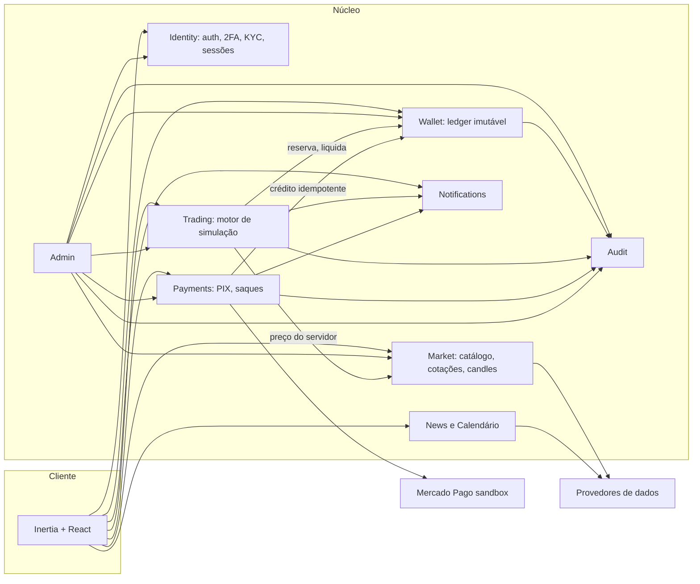

# Etapa 1 — Planejamento

> **Atualização de 07/11/2026:** o Mercado Pago foi substituído pela AmploPay (PIX) e a conta real foi implementada. As menções ao Mercado Pago abaixo são do planejamento original. Veja `docs/INTEGRACOES.md`.

Nome de trabalho do produto: **Nivora** (provisório; configurável em `APP_NAME`; verificar disponibilidade no INPI antes de usar publicamente).

Fatos sobre provedores e regulação verificados em 06/11/2026 nas fontes da seção 11. Planos e preços mudam: reconfirmar antes de contratar.

---

## 0. Restrições que moldam o projeto

| # | Fato | Consequência |
|---|------|--------------|
| 1 | A CVM tem emitido *stop orders* contra plataformas que captam brasileiros para opções binárias ou derivativos sem autorização (Olymp Trade, IQ Option, Deriv/Binary.com, 24 plataformas em nov/2025), com multa diária de R$ 1.000 por descumprimento | O modo real fica **desligado por construção**. A plataforma pública é um **simulador**. Isto não é parecer jurídico: a revisão por advogado é pré-requisito |
| 2 | A lista de atividades proibidas do Mercado Pago não pôde ser lida (HTTP 403) | Aceitação da categoria **não confirmada**. Só sandbox até haver resposta formal do Mercado Pago |
| 3 | A referência do Mercado Pago não lista endpoint de payout/transferência PIX | Saque fica como fluxo de solicitação e aprovação, atrás de uma interface `PayoutProvider` **sem implementação**. Nenhum saque pode aparecer como pago |
| 4 | Twelve Data grátis: "internal, non-display"; conta Business grátis: "evaluation only". Exibição a terceiros começa em US$ 149/mês | Plano grátis serve para desenvolvimento, não para lançamento público |
| 5 | FAQ da Binance (2022) proíbe uso comercial/streaming sem consentimento escrito | Binance pública serve para desenvolvimento. Lançamento público exige consentimento ou outro feed licenciado |
| 6 | Sem chaves, só cripto tem dados reais | Os demais ativos aparecem como **"sem dados"** e **não negociáveis**. Não existe fallback aleatório |
| 7 | Máquina atual: sem Docker, PostgreSQL ou Redis, em Windows | Desenvolvimento local em SQLite + filas/cache em banco; produção em PostgreSQL + Redis. O `docker-compose` não pode ser testado aqui |

Comunicação pública: a interface diz "simulador" / "conta demonstrativa", sem selos regulatórios, números de usuários ou depoimentos inventados.

---

## 1. Arquitetura

**Monólito modular** com processos separados para o que precisa rodar continuamente. Módulos têm fronteiras claras e podem virar serviços quando houver carga real que justifique.

```
 Navegador (React + Inertia + Lightweight Charts)
    │ HTTPS (sessão + CSRF)            │ WSS (somente leitura)
    ▼                                  ▼
 Nginx ──► Laravel HTTP (PHP-FPM)    Reverb (WebSocket)
              │                        ▲
              │                        │ broadcast
              ▼                        │
 ┌─────────────────── Domínios ────────┴───────────────┐
 │ Identity  Wallet(Ledger)  Market  Trading  Payments │
 │ Notifications  News  Support  Admin  Audit          │
 └───────┬──────────────────────┬──────────────────────┘
         ▼                      ▼
    PostgreSQL            Redis (cache, filas)
         ▲                      ▲
 ┌───────┴──────────────────────┴───────┐
 │ Workers independentes do frontend    │
 │  market:stream   feed WS do provedor │
 │  market:poll     feed REST           │
 │  trading:settle  liquidação          │
 │  queue:work      webhooks, e-mail    │
 │  schedule:work   rotinas             │
 └───────┬──────────────────────────────┘
         ▼
 Binance · Twelve Data · Finnhub · CoinGecko · Alpha Vantage · Massive · Mercado Pago
```

Invariantes:

1. O navegador envia só **intenção** (ativo, direção, valor, prazo). Preço de entrada, vencimento, payout e resultado são sempre do servidor.
2. **Dados de mercado** (`MarketDataProvider`) não podem executar ordens. A simulação vive em `OpenPosition` e `SettlePosition`; uma interface de execução só será extraída se um intermediário autorizado existir.
3. Saldo só muda via `LedgerService`. O ledger é append-only, com triggers no banco bloqueando `UPDATE` e `DELETE`.
4. Demo e real são carteiras distintas (`environment`), sem operação de transferência entre elas.
5. O modo real depende de `REAL_MONEY_ENABLED=false` (padrão) **e** de registro de aprovação jurídica; o código recusa operar sem ambos.

---

## 2. Tecnologias e justificativas

O briefing sugeriu Next.js + NestJS + Prisma e autorizou outra combinação, se justificada. Escolha: **Laravel + Inertia + React**.

| Camada | Escolha | Por quê |
|--------|---------|---------|
| Backend | **Laravel 13 / PHP 8.5** | O repositório já é Laravel. Traz autenticação, filas, scheduler, broadcasting, policies e notificações, reduzindo código crítico feito à mão |
| Ponte | **Inertia** | React sem um segundo servidor e sem token no navegador: sessão em cookie `HttpOnly` + CSRF, como exige a seção 17 |
| Frontend | **React 19, TypeScript, Tailwind 4, Zustand** | Conforme o briefing |
| Gráficos | **Lightweight Charts 5** (Apache-2.0, exige atribuição ao TradingView) | Conforme o briefing. Desenhos são implementados como primitivas próprias |
| Autenticação | **Laravel Fortify** | Cadastro, login, reset, verificação de e-mail, 2FA e rate limit já testados |
| Tempo real | **Laravel Reverb** | WebSocket próprio, sem custo por conexão |
| Banco | **PostgreSQL** (produção), SQLite (local) | Integridade e travas de linha em produção. Sem Prisma: as migrations do Laravel cobrem o necessário |
| Cache/filas | **Redis** (produção), banco (local) | Horizon não roda em Windows; entra só em produção |
| Dinheiro | Inteiros em centavos (`BIGINT`) | Sem erro de ponto flutuante |
| Preços | `DECIMAL(24,10)` tratados como string com `bcmath` | Comparação exata na liquidação |
| Senhas | **Argon2id** | Disponível no PHP instalado |
| Pagamentos | API REST do Mercado Pago | Só sandbox |
| Infra | Docker, Nginx, Cloudflare, GitHub Actions | Etapa 7 |

Custos desta escolha: um backend em PHP e um frontend em TypeScript (tipos compartilhados são mantidos à mão ou gerados), e o feed em PHP assíncrono é menos comum que em Node. Se a latência do feed virar gargalo, só esse worker é substituído.

---

## 3. Estrutura de pastas

```
app/
  Domain/
    Wallet/       LedgerService, Money, exceções
    Market/       Contracts/, Providers/{Binance,TwelveData,...}, MarketHours, QuoteStore
    Trading/      OpenPosition, SettlePosition, PerformanceSummary
    Payments/     Contracts/{PaymentProvider,PayoutProvider}, MercadoPago/ (etapa 4)
    Audit/        AuditLogger
  Console/Commands/      market:*, trading:*, wallet:reconcile
  Http/Controllers/      Páginas (Inertia) e Api/ (JSON com sessão)
  Http/Requests/         Validação
  Http/Resources/        Serialização da API
  Models/                Eloquent
  Policies/              Autorização
database/migrations, factories, seeders/   Catálogo de 200+ ativos
resources/js/
  pages/         Landing, Auth/*, Dashboard, Terminal, Assets/*, Wallet, History, Legal/*, Admin/*
  components/    ui, terminal/, chart/
  layouts/       AppLayout, GuestLayout, AdminLayout
  lib/           indicators/ (funções puras e testadas), api, format
  stores/        Zustand
tests/Unit, tests/Feature
docs/            Este plano, integrações, legal/
```

---

## 4. Diagrama dos módulos



---

## 5. Modelagem do banco de dados

Convenções: `BIGINT` em PK/FK; dinheiro em `*_cents`; preços em `DECIMAL(24,10)`; timestamps em UTC; `CHECK` onde o banco permitir.

### Identidade e acesso
| Tabela | Colunas principais | Regras |
|---|---|---|
| `users` | first_name, last_name, email, phone, password, status, email_verified_at, two_factor_*, birth_date | `email` único |
| `user_profiles` | user_id, cpf_encrypted, cpf_hash, locale, timezone, preferências | `cpf_hash` único; CPF cifrado |
| `user_sessions` | `sessions` do Laravel + `login_events` (ip, user_agent, resultado) | Histórico e dispositivos |
| `user_verifications` | user_id, type, status, provider, reviewed_by, reviewed_at | KYC; só libera real se aprovado |
| `roles`, `permissions`, pivôs | name | Permissões específicas, como `finance.adjust` |

### Carteira
| Tabela | Colunas principais | Regras |
|---|---|---|
| `accounts` | user_id, environment(demo/real), status | único (user, environment) |
| `wallets` | account_id, currency | **não guarda saldo** |
| `wallet_transactions` | wallet_id, seq, type, available_delta_cents, reserved_delta_cents, available_after_cents, reserved_after_cents, idempotency_key, reference, actor_id, reason, created_at | único (wallet, seq); único (wallet, idempotency_key); `CHECK` after ≥ 0; triggers contra `UPDATE`/`DELETE` |

O saldo é o `*_after_cents` da última linha do ledger. Não há campo de saldo editável.

### Pagamentos
| Tabela | Colunas principais | Regras |
|---|---|---|
| `deposits` | user_id, wallet_id, amount_cents, status, provider, provider_payment_id, qr_code, qr_code_base64, expires_at, idempotency_key | único (provider, provider_payment_id) |
| `withdrawals` | user_id, wallet_id, amount_cents, pix_key_encrypted, pix_key_type, status, reviewed_by, review_reason, provider_payout_id | `paid` só com confirmação do provedor |
| `payment_webhooks` | provider, event_id, signature_valid, payload, processed_at, error | único (provider, event_id) |

### Mercado
| Tabela | Colunas principais | Regras |
|---|---|---|
| `asset_categories` | code, name, sort | |
| `assets` | category_id, symbol, name, provider_code, provider_symbol, price_basis, trading_hours, payout_rate_bps, is_active | `symbol` único |
| `market_providers` | code, kind, status, last_ok_at, last_error, license_note | |
| `market_quotes` | asset_id, price, change_24h, change_pct_24h, high, low, volume, source, source_ts, received_at, data_quality(live/delayed/demo) | uma linha por ativo |
| `market_candles` | asset_id, interval, open_time, OHLCV, source | único (asset, interval, open_time) |
| `api_integrations` | provider, configured, rate limits, última chamada | **nunca guarda chave** |

### Negociação
| Tabela | Colunas principais | Regras |
|---|---|---|
| `trading_orders` | user_id, wallet_id, asset_id, direction, stake_cents, duration_seconds, status, reject_reason, idempotency_key | único (user, idempotency_key); guarda também as rejeições |
| `trading_positions` | order_id, entry_price, entry_source, entry_source_ts, opened_at, expires_at, payout_rate_bps, close_price, close_source, close_source_ts, result, payout_cents, settled_at, rules_version | `result` só é gravado uma vez (trigger) |
| `trading_executions` | position_id, event, payload, created_at | append-only |

**Desvio da lista do briefing:** `trading_history` e `trading_simulations` não viram tabelas. Histórico é consulta sobre posições encerradas, e os parâmetros de simulação são gravados na própria posição. Duplicar criaria duas fontes de verdade sobre resultados financeiros.

### Demais
`price_alerts`, `favorites`, `asset_views`, `notifications`, `support_tickets`, `support_messages`, `news_articles`, `economic_events`, `system_settings`, `audit_logs` (append-only), `admin_logs` (append-only).

### Regra de liquidação (`rules_version = 1`)

- **Entrada:** última cotação recebida pelo servidor; recusa se tiver chegado há mais de 5 s (medido pelo relógio do próprio servidor).
- **Vencimento:** próximo segundo cheio após o horário da cotação de entrada, mais o prazo, no relógio da fonte de preços. Assim, um relógio local atrasado não encurta o contrato.
- **Encerramento:** fechamento da vela de 1 s imediatamente anterior ao vencimento, consultada no provedor. Não há alternativa com cotação armazenada: `market_quotes` só guarda a última cotação.
- **Resultado:** CALL ganha se encerramento > entrada; PUT ganha se encerramento < entrada; igualdade é neutro (devolve o valor).
- **Sem referência confiável:** após 120 s do vencimento, a posição é anulada e o valor devolvido, com motivo registrado. Nunca se inventa preço.
- **Payout demo:** parâmetro configurável, gravado na abertura. Com 85%, o ponto de equilíbrio é acertar 54,05% das operações, e a interface mostra isso.

---

## 6. APIs utilizadas

| Provedor | Uso | Ordem | Situação |
|---|---|---|---|
| **Binance** (`data-api.binance.vision`, `data-stream.binance.vision`) | Cripto: cotação, velas, WS | 1º | Sem chave; acesso testado nesta máquina |
| **Twelve Data** | Forex, ações, ETFs, commodities | 2º | Precisa de chave |
| **Finnhub** | Notícias e cotações de ações | 3º | Precisa de chave |
| **CoinGecko** | Capitalização e metadados de cripto | 4º | Precisa de chave |
| **Alpha Vantage** | Reserva pontual | 5º | Precisa de chave |
| **Massive** (ex-Polygon) | Ações, se contratado | 6º | Pago |
| **Mercado Pago** | `POST /v1/payments` com `X-Idempotency-Key`; `GET /v1/payments/{id}`; webhooks com `x-signature` | Sandbox | Precisa de credenciais de teste |

A Binance cota em **USDT**, não em USD. Os ativos mantêm o símbolo pedido (`BTC/USD`), com `price_basis = USDT` visível na interface.

---

## 7. Limitações dos planos gratuitos

| Provedor | Grátis | Limite prático | Primeiro plano útil para exibição pública |
|---|---|---|---|
| Twelve Data | 8 créditos/min, 800/dia, WS só de teste | Cerca de 8 símbolos por minuto; uso interno sem exibição | Venture, US$ 149/mês |
| Alpha Vantage | 25 requisições/dia | Inviável para catálogo | US$ 49,99/mês (75/min); confirmar licença de exibição |
| CoinGecko | 100 chamadas/min, 10 mil/mês, atribuição; 1 ano de histórico | Sem licença comercial na coluna Demo | Basic, US$ 35/mês |
| Massive | Sem plano grátis na página atual; fontes de terceiros divergem | | Stocks Advanced, US$ 199/mês; termos comerciais em página separada |
| Finnhub | **Não confirmado** (documentação não legível por esta ferramenta) | Verificar limites e se o calendário econômico é premium | A confirmar |
| Binance | Sem chave | Uso comercial exige consentimento escrito (FAQ de 2022; confirmar) | Negociar com a Binance ou usar feed licenciado |

Índices e commodities não têm cobertura gratuita confirmada: ficam "sem dados" até haver plano adequado. O calendário econômico depende de confirmar a fonte.

**Conclusão:** 200+ ativos com dados exibíveis publicamente custam no mínimo cerca de US$ 149 a 184/mês em dados, mais o licenciamento de cripto. Com apenas as APIs grátis, o catálogo existe completo, mas só uma parte tem cotação.

---

## 8. Estratégia de integração financeira

Depósito em sandbox:

1. O usuário informa o valor; o backend valida e cria `deposits` como `pending`.
2. `POST /v1/payments` com `X-Idempotency-Key` derivada do depósito.
3. O frontend mostra QR Code e copia-e-cola.
4. Webhook: grava o evento bruto, valida `x-signature` e responde 200 (o prazo é de 22 s, com retentativas).
5. Fila: consulta `GET /v1/payments/{id}`. **Só o resultado dessa consulta confirma.** Valor e status vêm da API.
6. Crédito no ledger com `idempotency_key = deposit:{id}`. Webhook repetido não credita de novo (unicidade em dois níveis).

Saldo de sandbox: o crédito vai para uma carteira `sandbox`, nunca para a demo nem para a real, e não pode ser usado em operações.

Saque: `solicitado → em análise → aprovado/recusado`. A reserva do saldo ocorre na solicitação e é devolvida se recusado. Sem provedor de payout, o status termina em `aprovado — aguardando pagamento`, nunca em `pago`.

A assinatura do webhook é HMAC sobre `id`, `request-id` e `ts`. O formato exato do manifesto não apareceu no conteúdo lido da documentação; será confirmado na aba "Sem SDKs" ou no SDK oficial `mercadopago/dx-php` **antes** de implementar.

Pré-condições para o real, todas obrigatórias: parecer jurídico, autorização aplicável, aceite por escrito do Mercado Pago, KYC/AML operacionais, termos e política de riscos.

---

## 9. Estratégia de segurança

| Risco | Controle |
|---|---|
| Senhas | Argon2id, política mínima, verificação em duas etapas (TOTP) |
| Força bruta | Rate limit por IP + e-mail no login, reset e 2FA |
| XSS / SQLi / CSRF | Escape do React, consultas parametrizadas, CSRF de sessão, CSP |
| Sessão | Cookies `HttpOnly`, `Secure`, `SameSite`; lista e encerramento de dispositivos |
| Manipulação de saldo | Sem endpoint de saldo; só ledger; triggers; `wallet:reconcile` diário |
| Manipulação de resultado | Sem endpoint de edição; `result` gravado uma única vez, com trigger; eventos append-only |
| Corrida / clique duplo | `Idempotency-Key`, transação com `lockForUpdate`, unicidade (wallet, seq) |
| Webhook forjado | Assinatura + consulta à API oficial |
| Dados sensíveis | CPF e chave PIX cifrados; hash para busca; LGPD (retenção, exportação, exclusão) |
| Segredos | Só em ambiente; nunca no frontend nem no banco |
| Admin | Autenticação separada, 2FA obrigatório, permissões, justificativa e auditoria |
| Exposição indevida do real | `REAL_MONEY_ENABLED=false`, sem rota ativa |

Conflito de interesses: num modelo real em que a casa ganha quando o cliente perde, o conflito é estrutural. A auditoria mitiga, não elimina; o tema vai para a revisão jurídica.

---

## 10. Cronograma

Estimativa para uma pessoa em tempo integral. É uma ordem de grandeza, não um compromisso.

| Etapa | Conteúdo | Prazo estimado |
|---|---|---|
| 1 | Planejamento | Concluída |
| 2 + 3 | Interface e backend, em fatias verticais | 4–6 semanas |
| 4 | Integrações (mercado, WS, notícias, calendário, Mercado Pago sandbox) | 2–3 semanas |
| 5 | Administração | 2–3 semanas |
| 6 | Segurança, testes, monitoramento | 2 semanas |
| 7 | Produção: infraestrutura, carga, documentação | 2 semanas + prazo jurídico |

As etapas 2 e 3 são feitas juntas porque a regra do briefing proíbe tela sem backend. Ordem das fatias: fundação → carteira → catálogo → cotações → motor de simulação → terminal → dashboard → demais módulos.

---

## 11. Fontes

- CVM: [24 plataformas (13/11/2025)](https://www.gov.br/cvm/pt-br/assuntos/noticias/2025/cvm-alerta-para-atuacao-irregular-de-24-plataformas-digitais), [Deriv/Binary.com](https://www.gov.br/cvm/pt-br/assuntos/noticias/2023/cvm-alerta-para-atuacao-irregular-de-deriv-com-e-binary.com), [Olymp Trade](https://www.gov.br/cvm/pt-br/assuntos/noticias/2022/cvm-reitera-alerta-relativo-a-atuacao-irregular-no-mercado-de-valores-mobiliarios), [IQ Option](https://www.gov.br/cvm/pt-br/assuntos/noticias/2021/cvm-reforca-alerta-de-atuacao-irregular-da-iq-option-ltd)
- Polícia Federal, opções binárias e apostas ilegais: [SBT News](https://sbtnews.sbt.com.br/noticia/policia/pf-mira-esquema-de-opcoes-binarias-e-apostas-ilegais-que-desviou-mais-de-r-50-milhoes)
- Mercado Pago: [referência](https://www.mercadopago.com.br/developers/pt/reference), [PIX](https://www.mercadopago.com.br/developers/pt/docs/checkout-api-payments/integration-configuration/integrate-pix), [webhooks](https://www.mercadopago.com.br/developers/pt/docs/your-integrations/notifications/webhooks), [atividades proibidas (403, não lida)](https://global-selling.mercadopago.com/help/18572)
- Dados: [Twelve Data](https://twelvedata.com/pricing.md), [CoinGecko](https://www.coingecko.com/en/api/pricing), [Alpha Vantage](https://www.alphavantage.co/premium/), [Massive](https://massive.com/pricing), [Binance FAQ](https://www.binance.com/en-BH/support/faq/how-to-download-historical-market-data-on-binance-5810ae42176b4770b880ce1f14932262), [Binance Vision Terms](https://data.binance.vision/Binance_Vision-Terms_of_Use.pdf)

**Não confirmado:** a citação de um site de terceiros ([Suno](https://www.suno.com.br/artigos/opcoes-binarias/amp/)) à "Deliberação CVM 598/2018" como proibição expressa não foi localizada em fonte oficial, e por isso não é usada como base aqui.
